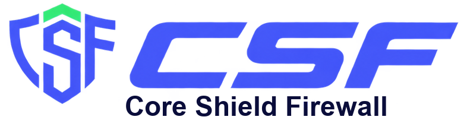
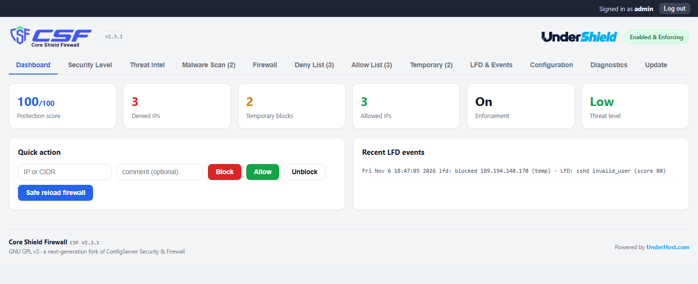
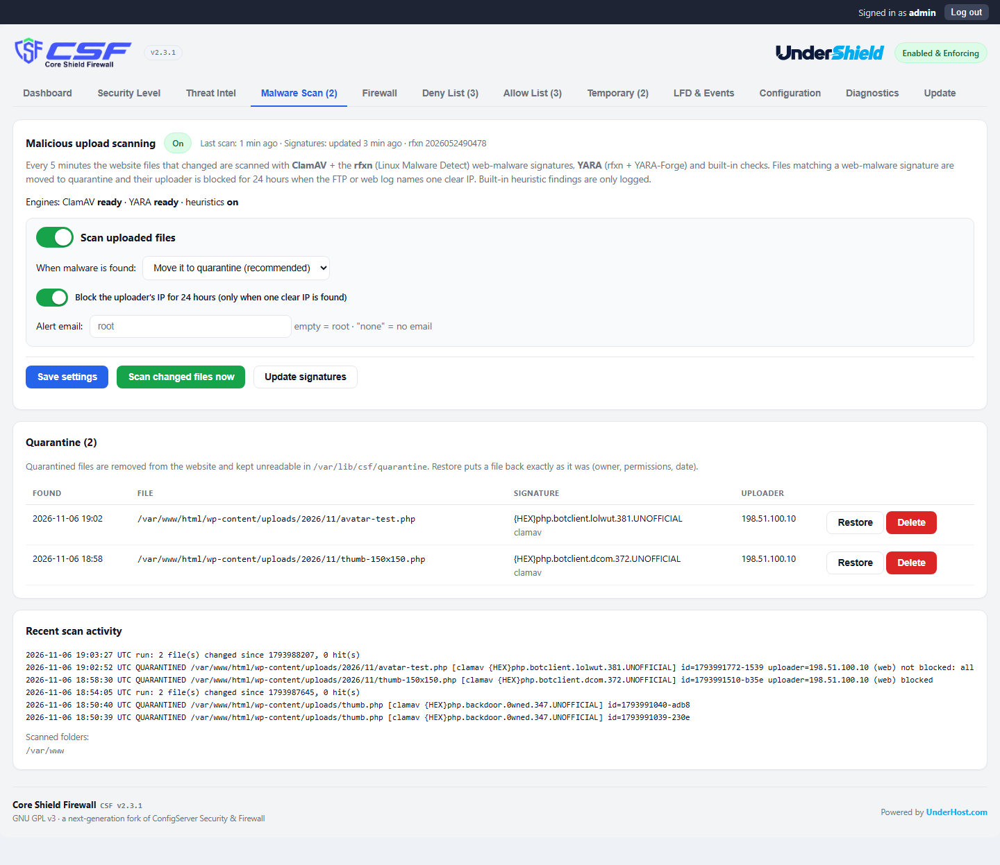
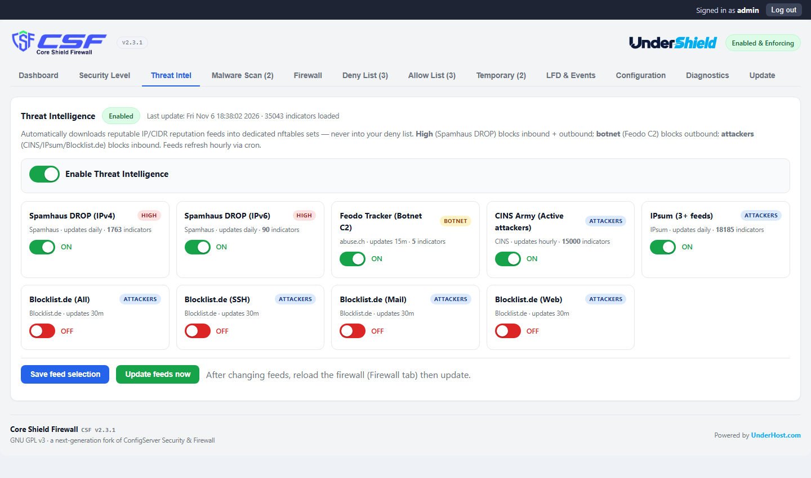
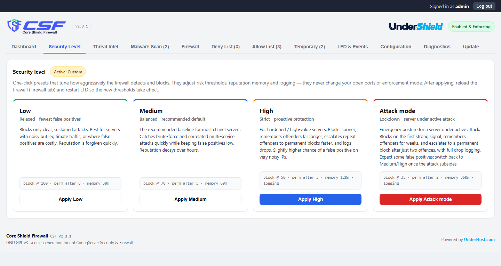
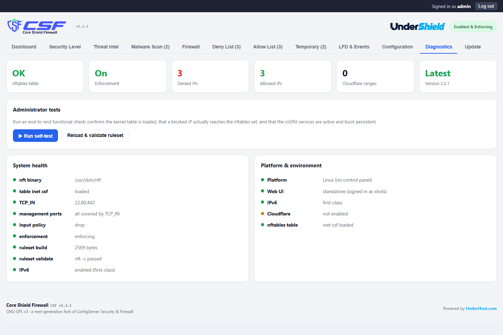
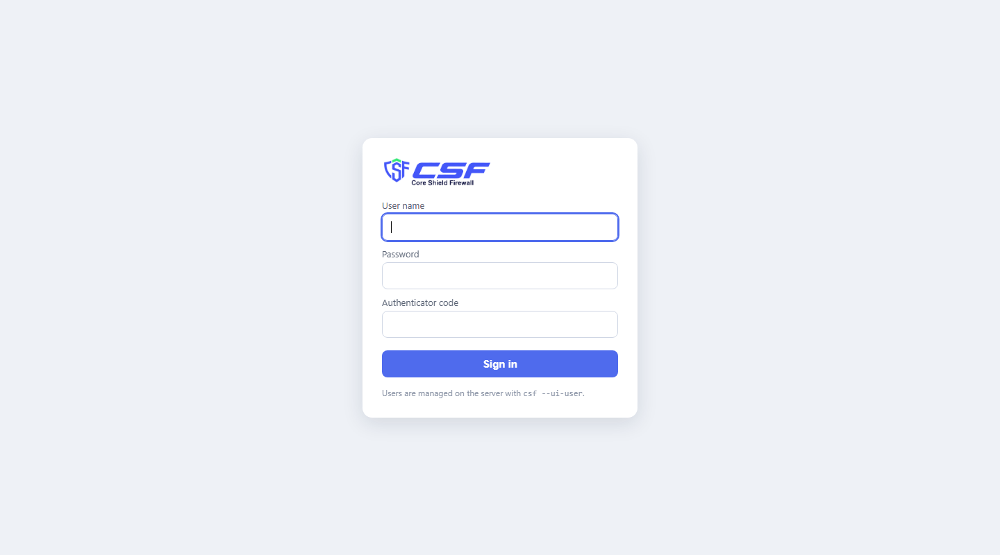

<p align="center">
  <picture>
    <source media="(prefers-color-scheme: dark)" srcset="docs/images/csf-logo-dark.png">
    
  </picture>
</p>

<p align="center">
  <b>A modern firewall and intrusion-prevention system for cPanel &amp; WHM, CloudPanel and Linux servers.</b><br>
  Native nftables &middot; IPv4 + IPv6 &middot; LFD 2.0 &middot; Threat Intelligence &middot; Malware upload scanning
</p>

<p align="center">
  <a href="https://shield.underhost.com/firewall/download/"></a>
  <a href="LICENSE"></a>
  <a href="https://github.com/UnderHost/csf/actions/workflows/tests.yml"></a>
  <a href="https://shield.underhost.com/firewall/docs/"></a>
</p>

---

**CSF - Core Shield Firewall** (formerly *cPanel Shield Firewall*) is a next-generation fork of
ConfigServer Security &amp; Firewall. It keeps the workflow administrators already know - the
`csf` command and the `csf.conf`, `csf.allow`, `csf.deny` and `csf.ignore` files - and rebuilds
the foundation on **native nftables** with first-class IPv6, an event-driven **LFD 2.0** with risk
scoring, live **Threat Intelligence** and **malicious upload scanning**.

It runs on **cPanel &amp; WHM** (as a WHM plugin), on **CloudPanel**, and on Linux servers with
**no control panel** (with its own secure web interface). CSF is part of
[UnderShield](https://docs.underhost.com/article/undershield-server-monitoring/), built and
maintained by [UnderHost](https://underhost.com).

## Features

- **nftables-first engine** - one `table inet csf` with timeout-capable sets for IPv4 and IPv6.
  Blocking an IP updates a set element, never a full rule rebuild.
- **LFD 2.0** - event-driven detection for SSH, mail, FTP, cPanel/WHM and the web interface, with
  risk scoring and escalating blocks for repeat attackers. Reads log files or the systemd journal.
- **Threat Intelligence** - Spamhaus DROP, Feodo Tracker (botnet C2), CINS Army, IPsum and
  Blocklist.de feeds in dedicated sets, refreshed automatically and never mixed into your deny list.
- **Malicious upload scanning** - website files that changed are scanned every 5 minutes with
  ClamAV (rfxn / Linux Malware Detect signatures) and YARA. Malware is quarantined and the uploader
  is blocked for 24 hours; restore or delete with one click.
- **Safe administration** - `csf --safe-reload` applies a new ruleset and rolls it back
  automatically unless you confirm; management ports are protected from lockout.
- **Web interface** - the WHM plugin on cPanel, or a standalone interface on `127.0.0.1` with
  password + two-factor (TOTP) sign-in, CSRF protection and lockout, published through an SSH tunnel
  or your own HTTPS domain (automatic on CloudPanel).
- **Security levels** - one-click Low / Medium / High / Attack mode presets.
- **Cloudflare** - one-click allowlist of Cloudflare edge ranges.
- **Self-test** - `csf --selftest` checks that the firewall, LFD and scanner really protect the server.
- **One-click updates** - verified (SHA-256) in-place updates from the release channel.
- **Migration** - installs over legacy ConfigServer CSF v15 and the cPanel-maintained CSF,
  migrating your configuration and lists.

## Screenshots

| | |
|---|---|
|  |  |
| **Dashboard** - protection score, quick actions, recent LFD events | **Malware Scan** - upload scanning, quarantine with restore / delete |
|  |  |
| **Threat Intel** - reputation feeds with per-feed switches | **Security Level** - one-click presets |
|  |  |
| **Diagnostics** - health checks and platform | **Sign-in** - password + two-factor authentication |

## Supported systems

| System | Status |
|---|---|
| AlmaLinux 8 / 9 / 10 | Tested |
| Rocky Linux 9 | Tested |
| CloudLinux 9 | Tested |
| Ubuntu 22.04 / 24.04 / 26.04 LTS | Tested |
| Debian 12 / 13 (CloudPanel or no panel) | Tested |
| CloudLinux 8 / 10, RHEL and Rocky 8 / 10 | Supported |

| Control panel | Interface |
|---|---|
| cPanel &amp; WHM | WHM plugin |
| CloudPanel | Standalone web interface, published on your own HTTPS domain |
| No control panel | Standalone web interface (SSH tunnel or your reverse proxy) |

*Tested* means every release is installed on a clean server of that system, enforced, rebooted and
attacked with a real SSH brute force. Requirements: a kernel with nftables and Perl 5 (the installer
adds any missing core modules and nftables itself). Run as root.

## Install

```sh
# download + verify the checksum
curl -fSLO https://shield.underhost.com/firewall/download/csf-2.3.2.tar.gz
curl -fSLO https://shield.underhost.com/firewall/download/csf-2.3.2.tar.gz.sha256
sha256sum -c csf-2.3.2.tar.gz.sha256

# install: detects cPanel, CloudPanel or no panel and sets the ports
tar xzf csf-2.3.2.tar.gz
cd csf2 && sh install.sh
```

The installer runs the test suite first, installs in **TESTING** mode (rules generated and
validated, not enforced), and prints the next steps for your platform. When you have reviewed
`/etc/csf/csf.conf` and its ports, enforce with an automatic rollback:

```sh
sed -i 's/^TESTING *= *"1"/TESTING = "0"/' /etc/csf/csf.conf
csf --safe-reload        # rolls back automatically unless you confirm
csf --confirm
systemctl enable --now csf.service lfd.service
csf --selftest
```

**CloudPanel or no panel** - create a web interface login (password + authenticator code):

```sh
csf --ui-user add admin
# CloudPanel: publish the interface on your own HTTPS domain (Let's Encrypt included)
CSF_UI_DOMAIN=fw.example.com sh install.sh
# any server: ssh -L 6789:127.0.0.1:6789 root@your-server  ->  http://127.0.0.1:6789
```

**Malware scanning** - `csf --scan-setup` installs ClamAV and YARA and turns scanning on.

Step-by-step guides: [no control panel](https://docs.underhost.com/article/csf-firewall-no-panel/) &middot;
[CloudPanel](https://docs.underhost.com/article/csf-firewall-cloudpanel/) &middot;
[full documentation](https://shield.underhost.com/firewall/docs/).

## Update

From the **Update** tab of the interface, or:

```sh
csf --self-update
```

The updater reads the stable channel (`https://shield.underhost.com/firewall/releases/latest.json`),
verifies the SHA-256 of the package and reinstalls, keeping your configuration, allow / deny lists
and Threat Intelligence sets.

> **Running 2.1.x or 2.2.x?** Update to 2.3.0: earlier versions did not start the firewall after a
> reboot. See the [changelog](CHANGELOG.md).

## Common commands

```sh
csf -d 203.0.113.10 "reason"     # block (deny list)
csf -a 198.51.100.5 "office"     # allow
csf -td 192.0.2.7 2h             # temporary block
csf -g 203.0.113.10              # inspect an IP: is it blocked, and why?
csf -dr / -ar / -tr <ip>         # remove a deny / allow / temporary entry
csf --safe-reload                # apply changes with automatic rollback
csf --selftest                   # end-to-end protection check
csf --ti-update                  # refresh Threat Intelligence feeds
csf --scan /path --report-only   # scan a folder without changing anything
csf --quarantine list            # quarantined files (restore <id> / delete <id>)
csf -h                           # all commands
```

## Development

```sh
sh run-tests.sh                  # the full test suite (also run by the installer)
```

Source layout and guidelines: [CONTRIBUTING.md](CONTRIBUTING.md). Security reports:
[SECURITY.md](SECURITY.md) - please do not open public issues for vulnerabilities.

## License

CSF - Core Shield Firewall is free software under the
[GNU General Public License v3.0](LICENSE) or later. It is a fork of ConfigServer Security &amp;
Firewall (GPL v3) - see [NOTICE](NOTICE) for credits and third-party data.

cPanel and WHM are registered trademarks of cPanel, L.L.C. UnderHost and CSF are not affiliated with
or endorsed by cPanel, L.L.C.
